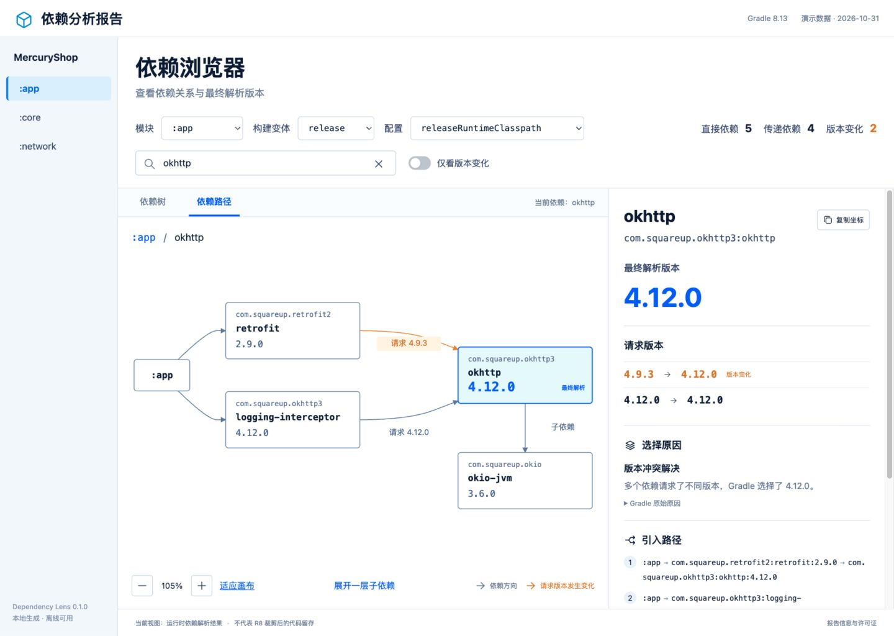

# Dependency Lens

Android 依赖分析 Gradle 插件。针对各生产变体的编译与运行时依赖生成单个离线 HTML 报告，可在依赖树与路径图中查看请求版本、最终解析版本、选择原因、子依赖和多条引入路径。界面使用原生前端与固定版本的 Dagre 1.1.5。



仓库中的 [界面演示](reports/demo.html) 使用明确标记的演示数据；[Android 示例报告](reports/android-example.html) 由真实 AGP 和可控 fixture 依赖生成。请下载 HTML 后在本地查看，或在仓库根目录运行 `python3 scripts/preview.py`，通过 `http://127.0.0.1:4173/` 访问。GitHub 文件页面本身不是交互预览。[设计对照与交互验收](design-qa.md) 记录了截图和验收范围。

## 快速使用

### 1. 构建并发布到本机 Maven

插件工程使用 **JDK 11、Gradle Wrapper 7.0.2** 构建；`check` 中的前端测试需要 Node.js 18 或更新版本。使用已安装的 JDK 11 设置 `JAVA_HOME` 后执行：

```bash
./gradlew check publishToMavenLocal --no-configuration-cache
```

macOS 可以使用 `export JAVA_HOME=$(/usr/libexec/java_home -v 11)` 选择 JDK。消费插件的 Android 工程使用它自己 AGP 所要求的 Gradle 与 JDK，AGP 8+ 示例使用 JDK 17。

### 2. 在 Android 根工程接入

在 `settings.gradle.kts` 的插件仓库中添加本机 Maven：

```kotlin
pluginManagement {
    repositories {
        mavenLocal()
        google()
        mavenCentral()
        gradlePluginPortal()
    }
}
```

在根工程统一声明 AGP，子模块应用对应 Android 插件。将 Dependency Lens 应用一次即可：

```kotlin
plugins {
    id("com.android.application") version "8.13.2" apply false
    id("com.android.library") version "8.13.2" apply false
    id("dev.dependencylens") version "0.1.0"
}
```

这里的 AGP 版本是接入示例，实际工程使用自己的版本。Groovy DSL 对应声明：

```groovy
plugins {
    id 'com.android.application' version '8.13.2' apply false
    id 'com.android.library' version '8.13.2' apply false
    id 'dev.dependencylens' version '0.1.0'
}
```

### 3. 生成报告

```bash
./gradlew dependencyLensReport --no-configuration-cache
```

报告输出到根工程的 **`build/reports/dependency-lens/index.html`**。数据、脚本、图标、样式和第三方许可证均内嵌在文件中，可复制供离线查看。当前界面验收使用内置 Chromium 的本地 HTTP 预览；直接以 `file://` 打开尚未实机验收。

## 分析范围

- 自动汇总当前 build 内的 Android 应用、库与 Dynamic Feature 模块。
- 按所有已启用的生产变体采集 `RuntimeClasspath`、`CompileClasspath`。
- 运行时与编译时的版本结果独立保存；测试、注解处理器、构建脚本依赖不在首版范围内。
- 依赖项目中的 Java/Kotlin 模块和 Included Build 组件可以作为节点追踪；不会在其他 build 内另行执行采集任务。
- 工程需要能够完成 Gradle 配置。单项解析失败会保留成功部分并明确标记；工程配置阶段本身失败时遵循 Gradle 的失败行为。
- 报告读取 Gradle 实际解析结果，遵守项目已有的仓库、依赖锁、强制规则、约束与替换，不修改依赖。
- 报告不依赖编译或打包任务；本地文件只展示当前可发现的文件，不推测文件里的外部传递依赖。

**最终解析版本对应指定 Configuration，不等同于 APK/AAB 中经 R8 裁剪后的代码留存。** 对 Android Library 模块，运行时依赖也不代表这些依赖被嵌入了 AAR。

## 筛选与输出

只分析指定模块、变体：

```bash
./gradlew dependencyLensReport \
  -PdependencyLens.modules=:app,:core \
  -PdependencyLens.variants=release \
  --no-configuration-cache
```

参数采用逗号分隔的精确名称。Flavor 变体需要使用完整名称，例如 `freeRelease`。所选变体可存在于选中模块的任意一个模块；不包含该变体的模块不会写入报告。未知模块、未知变体、空参数均报错，不会把旧报告内容混进新结果。

自定义位置，Kotlin DSL：

```kotlin
dependencyLens {
    outputFile.set(layout.buildDirectory.file("reports/dependencies.html"))
}
```

Groovy DSL：

```groovy
dependencyLens {
    outputFile.set(layout.buildDirectory.file('reports/dependencies.html'))
}
```

生成过程正常使用 Gradle 的元数据缓存；需要离线生成时额外加 `--offline`，缺失缓存会在报告中显示为解析问题。首次生成仍可能需要联网获取依赖元数据；**离线查看报告**始终不需要联网。

## 页面操作

- **依赖树**：按需展开子依赖，展示每条关系的请求版本与最终版本。同一组件可以在不同路径中出现。
- **搜索**：支持坐标、名称和请求版本，保留匹配节点的普通祖先路径；筛选期间路径自动展开。
- **仅看版本变化**：定位固定版本变化或组件替换；动态版本与约束定版有单独标记，不直接算成版本冲突。
- **依赖路径**：选中依赖后切换，查看相关上游关系；请求版本标在连线上，多个来源汇入相同的已选变体节点。
- **子依赖**：路径图默认展开选中节点的一层子依赖，可以继续展开。
- **缩放与平移**：支持按钮、滚轮和画布拖动；“适应画布”恢复整体视野。
- **树中定位**：自动清除搜索筛选，展开并定位一条最短引入路径。
- **详情**：查看全部选择原因、每个直接来源的一条最短路径、约束来源、直接子依赖、变体属性与 Capability。完整路径关系通过图展示，不穷举组合路径。
- **大图**：默认最多绘制 200 个相关节点，明确提示折叠数量并允许继续展开。依赖树每次最多增加 500 行。
- **离线复制**：浏览器允许时直接复制坐标；不允许时显示可选中文本。

## 示例工程

先在插件根目录生成可控的本地 Maven 样例：

```bash
python3 scripts/create-fixture-repo.py
```

- `examples/android`：Groovy DSL，4 个 Android 模块，包含 Flavor、禁用变体、Dynamic Feature、模块依赖、本地 JAR、编译时／运行时专有依赖。
- `examples/kotlin-dsl`：通过真实插件 Marker 从本地 Maven 接入，演示 Kotlin DSL 与自定义输出文件。

在示例中设置自己的 Android SDK（`ANDROID_HOME` 或 `local.properties`），使用 JDK 17 执行各示例自己的 `./gradlew dependencyLensReport --no-configuration-cache`。Kotlin DSL 示例输出到 `build/reports/dependency-lens/custom.html`。

样例坐标为 `lens.fixture:*`，由本地仓库生成，避免将演示关系误认为第三方库的真实元数据。`scripts/render-demo.py` 另外生成与设计稿接近的界面演示，页面明确标记“演示数据”；兼容验证使用真实 AGP 与独立的本地 Maven 测试依赖。

重新生成界面演示：`python3 scripts/render-demo.py`，输出 `reports/demo.html`。如需 HTTP 预览，可运行 `python3 scripts/preview.py`，打开 `http://127.0.0.1:4173/`；插件生成的报告本身不需要服务器。

## 兼容性与测试

兼容目标为 AGP 7.0.x～9.5.x。锁定的 27 个组合中，22 个通过，5 个因 TLS 下载阻断而未完成，不能据此认为整个目标区间均已验证。JVM 测试 14 项和前端测试 9 项通过。Safari、独立 Chrome 和直接以 `file://` 打开尚未实机验收。具体结果见 [验证记录](docs/VALIDATION.md) 和 [兼容矩阵](docs/compatibility-matrix.json)。

```bash
# 单元、Gradle TestKit、前端逻辑与插件校验
./gradlew check --no-configuration-cache

# Android 边界矩阵，需要 SDK 与 JDK 11/17
python3 scripts/compatibility.py --matrix smoke --sdk /path/to/android-sdk

# 全部锁定组合
python3 scripts/compatibility.py --matrix full --sdk /path/to/android-sdk
```

macOS 自动查找 JDK；其他系统或自定义安装可设置 `LENS_JAVA_11`、`LENS_JAVA_17`。测试工作目录默认在 `build/compatibility`，可用 `--work-dir` 指定。工具下载官方 Gradle 分发包并校验官方 SHA-256。

首版报告任务不支持 Configuration Cache，必须使用 `--no-configuration-cache`；普通构建不会自动触发报告。Isolated Projects 不属于首版兼容范围。

## 发布到 Maven 仓库

工程启用了 `java-gradle-plugin` 与 `maven-publish`，同时生成插件实现包和 Marker。目前仅验证过本地 Maven 发布，尚未公开发布到 Gradle Plugin Portal。

向私有 Maven 仓库发布时，设置环境变量 `ORG_GRADLE_PROJECT_targetUsername`、`ORG_GRADLE_PROJECT_targetPassword`，然后执行：

```bash
./gradlew publish -PpublishRepositoryUrl=https://your-maven-repository.example/releases
```

消费工程将同一个 Maven 地址放入 `pluginManagement.repositories`，继续用 `id("dev.dependencylens") version "0.1.0"` 接入。仓库凭据不应写入源码。Gradle Plugin Portal 的公共注册与命名空间验证需由发布者在正式公开发布时处理，本工程不会自动进行公开发布。

## 维护说明

- `src/main/java/dev/dependencylens`：插件接入，`analysis` 为图采集，`report` 为 HTML 生成。
- `src/main/resources/dev/dependencylens/report`：按依赖树、路径、详情及共享图操作组织的原生前端。
- `src/test`：可控本地 Maven 仓库的解析测试，以及万级节点图算法测试。
- 页面元数据使用文本节点，内嵌 JSON 转义 `<` 等字符；报告 CSP 禁止网络连接。错误摘要省略仓库路径、查询参数、凭据和常见用户目录。
- 运行时不打包 AGP 或另一份 Groovy/Kotlin 运行时，使用宿主 Gradle 的公开 JSON API。
- 撤销接入只需移除根工程插件声明；生成的文件位于构建目录。
- 第三方许可原文见 [THIRD-PARTY-NOTICES.txt](THIRD-PARTY-NOTICES.txt)，报告内也包含原文。
